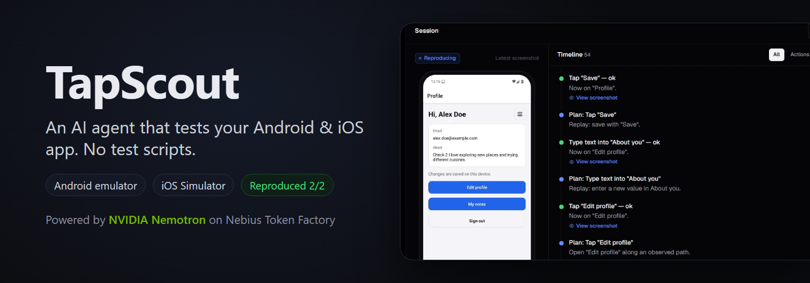
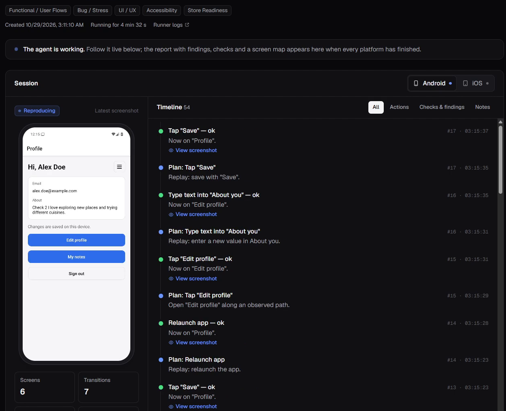
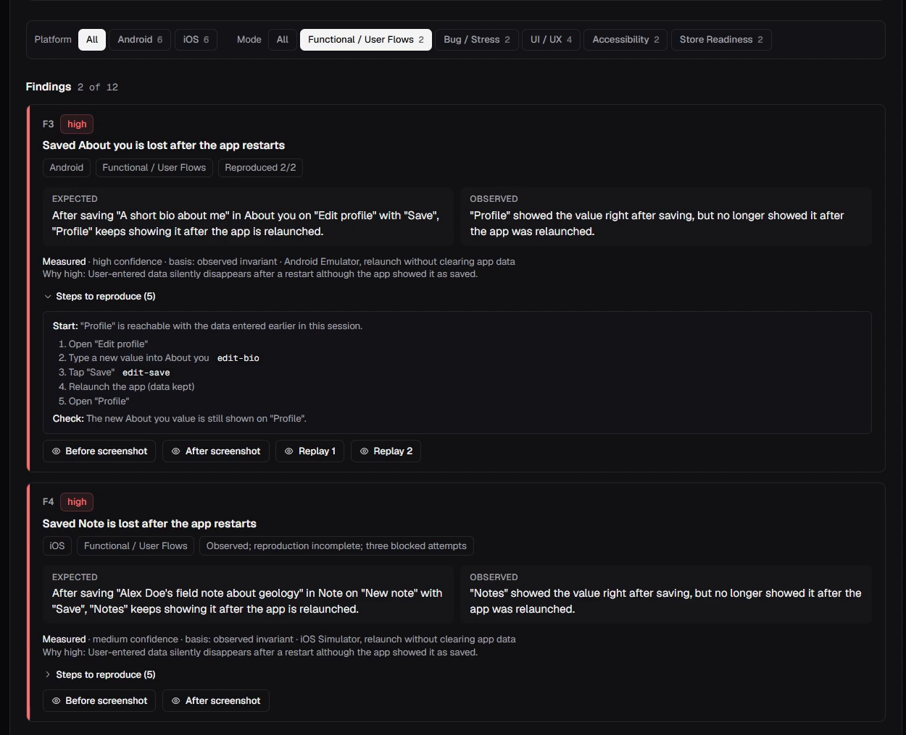
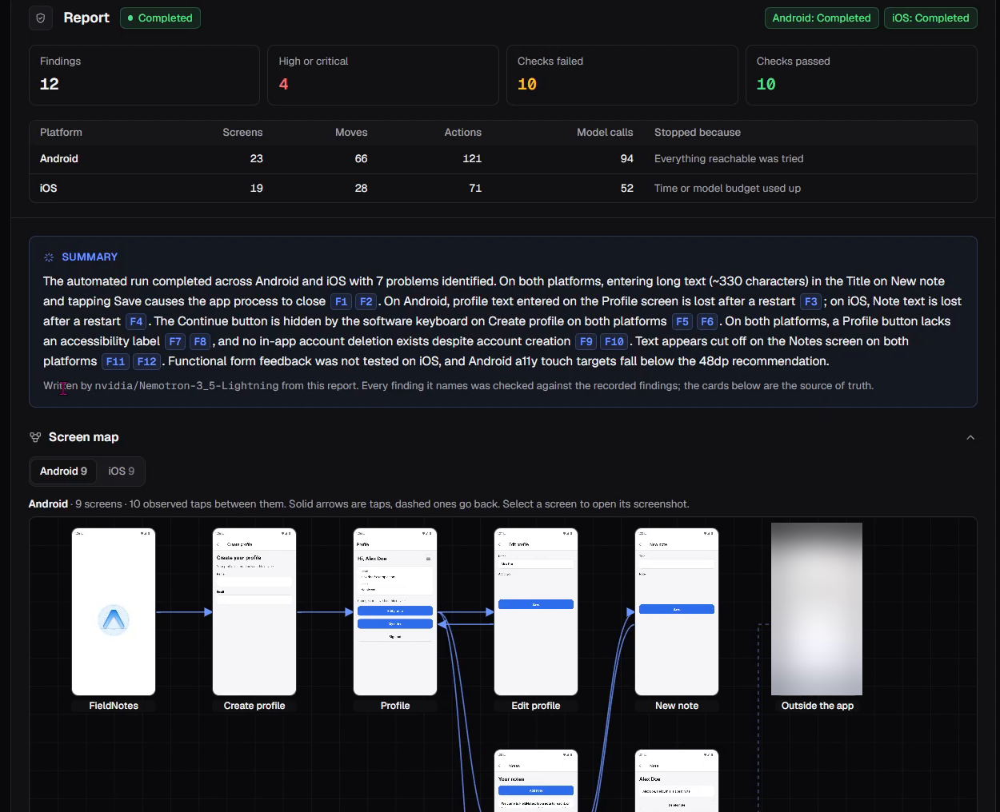
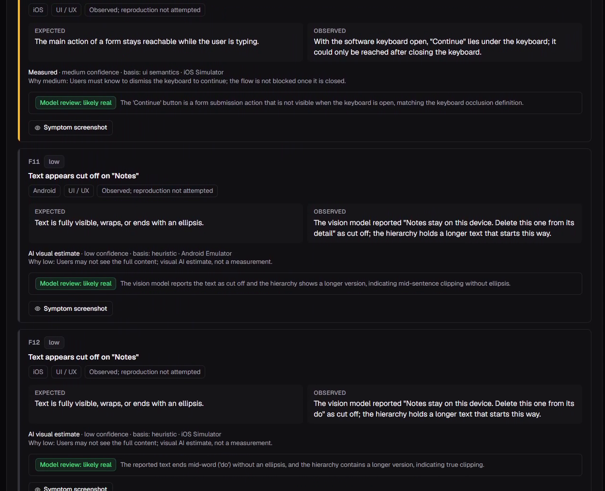
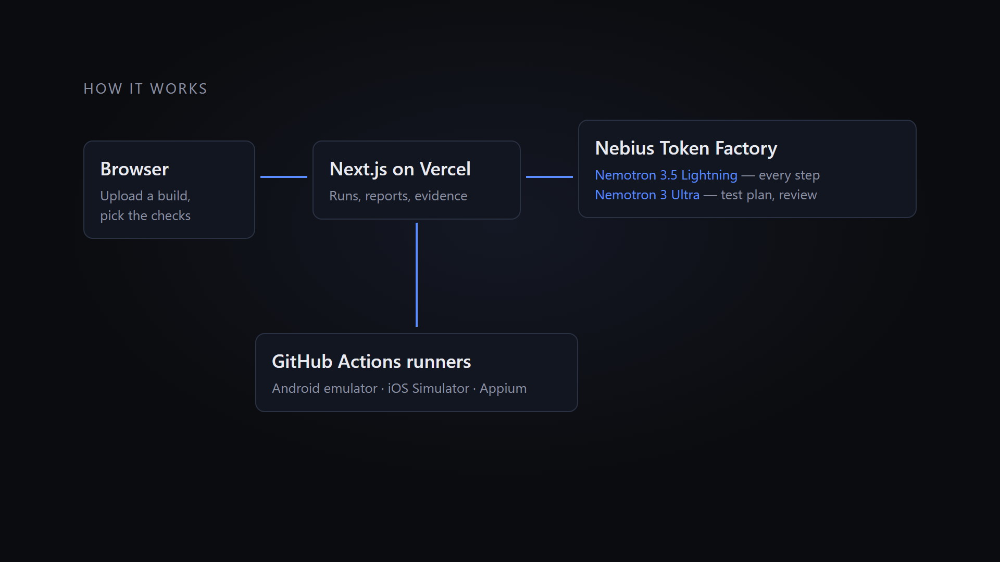

# TapScout

[](https://youtu.be/8fvmCpTaPKA)

**An autonomous QA agent for mobile apps.** Upload an Android APK and/or an iOS Simulator build,
pick what to test, and an agent driven by **NVIDIA Nemotron** explores the app on a real Android
emulator and iOS Simulator — no test scripts, no recorded flows. You watch both devices live, and
get a report where every finding carries screenshots, the steps that led to it and an honest
reproduction rate (`Reproduced 2/2`).

**[▶ Demo video (2:50)](https://youtu.be/8fvmCpTaPKA)** · **[Live demo](https://tap-scout-zeta.vercel.app)** ·
**[Devpost](https://nebiusglobalaihackathon.devpost.com/)** · [Apache-2.0](LICENSE)

Built during the [Nebius x NVIDIA Global AI Hackathon](https://nebiusglobalaihackathon.devpost.com/)
(track: *Coding and Agentic Engineering*). Every model call goes to **Nebius Token Factory** at
runtime. Sign-in details for judges are in the Devpost testing instructions (public sign-up is
closed).

| | |
|---|---|
| **6 / 6** planted bugs found on Android *and* iOS, 0 false alarms | showcase run on the sample app |
| **6 real open-source apps**, 5 UI frameworks | most main screens reached in one session, one real crash found |
| **~$0.016** in model calls per platform session | Nemotron Lightning every step, Ultra where judgement matters |
| **0** test scripts | the agent decides every tap itself and writes down why |

---

## What it does

1. **Upload** an `.apk` and/or a zipped iOS Simulator `.app` (up to 200 MB each), or use the
   built-in sample app. Optionally add a **test account** (for apps behind a sign-in) and a
   **test note** ("focus on adding a note").
2. **Start a test** with the modes you want. Each platform gets its own fresh device on a
   GitHub-hosted runner; both run in parallel.
3. **Watch it live**: every planned action, the reason for it, and the screenshot after it.
4. **Read the report**: findings grouped by platform and mode, each with expected vs. observed,
   evidence, replay steps and how often it reproduced; a coverage table of the screens reached;
   and a short summary written by Nemotron that may only cite facts in the report.

**Live run** — the agent has just saved a profile, relaunched the app and is replaying the steps
to confirm the saved text is gone:



**A finding** — expected vs. observed, how it was measured, the exact steps, and the screenshots of
each replay:



<details>
<summary><b>More: report overview with screen map, Nemotron Ultra triage verdicts</b></summary>





</details>

### Test modes

| Mode | What the agent checks |
|---|---|
| Functional / User flows | Reaches screens and flows, fills forms, checks that saved data survives a relaunch |
| Bug / Stress | Empty, long and emoji input, background/foreground, keyboard, bounded rapid taps, crashes |
| UI / UX | Controls covered by the keyboard, clipped text (confirmed by a vision model) |
| Accessibility | Missing labels, small touch targets |
| Store readiness | In-app account deletion, reachable privacy policy |

A check the platform cannot run is reported as `Unsupported`; one the session did not reach is
`Not tested`. TapScout never invents a coverage percentage for an app of unknown size.

## How NVIDIA Nemotron is used

All calls go through a server-side relay to Nebius Token Factory's OpenAI-compatible API, so keys
never reach the device runner or the browser.

| Role | Model | When |
|---|---|---|
| **Planner** — picks the next action on the current screen, with a reason and an expected outcome | `nvidia/Nemotron-3_5-Lightning` (JSON schema output, reasoning off, ~1 s per call) | Every step, up to 90 calls per platform |
| **Test plan** — writes app-specific goals once the first screens are known | `nvidia/Nemotron-3-Ultra-550b-a55b` | Once per session |
| **Triage** — reviews heuristic findings and lowers likely false positives | `nvidia/Nemotron-3-Ultra-550b-a55b` | End of session |
| **Report summary** — summarises the merged report; every claim is checked against it | `nvidia/Nemotron-3_5-Lightning` | End of run |
| Vision — confirms clipped text; locates controls on screens with no accessibility data (games, canvases) | `openbmb/MiniCPM-V-4_5` | Only when needed |

The planner's answer is validated against a strict schema and against the current screen before
anything touches the device. Screen text is treated as data under test, never as instructions.
A platform session costs about **$0.016** in model calls.

**Why Token Factory made this practical.** One OpenAI-compatible endpoint serves every model above,
so each role uses the size it needs: Lightning answers in about a second with schema-constrained
JSON, which is what makes a step-by-step agent fast enough to run 90 steps in a session; Ultra is
called only once or twice, where a better judgement is worth the latency. Swapping a model for a
role is a config change, which let us compare candidates on the same runs (`pnpm probe:models`,
`quality/triage-eval.mjs`) before choosing.

## How it works



```
Browser ──► Next.js on Vercel (UI, API, model relay) ──► Nebius Token Factory (Nemotron, VLM)
   ▲                 │ workflow_dispatch
   │ Realtime        ▼
Supabase ◄──── GitHub Actions: Android emulator (Linux + KVM) │ iOS Simulator (macOS)
(Auth, Postgres,      Appium + TapScout runner: observe → plan → validate → act → check
 Realtime, Storage)
```

- **Observe:** the runner reads the screen's accessibility tree and a screenshot, and normalises
  both platforms into one element list. Secrets are masked before anything leaves the device.
- **Plan:** Nemotron gets the elements, the app's test plan and what has been tried; it answers
  with one action. Deterministic rules handle what a model should not: system permission dialogs,
  onboarding, tours to untried controls, leaving screens where nothing changes.
- **Act and check:** the action runs through Appium; the result is compared with the expectation.
  Candidate issues are replayed up to four times before they become findings.
- **Safety:** the agent never taps controls that act on other people or cost money (send, post,
  follow, report, vote, buy, prices) and does not sign in to real servers without a test account.

## Measured results

Quality is measured against ground truth the agent never sees (`quality/`, checked by
`scripts/check-ground-truth.sh`).

**Sample app with planted bugs** (FieldNotes, `apps/sample-app`): the seeded build has six known
issues; recent runs find 5–6 of 6 on Android and iOS, and the shared showcase run found all six on
both platforms with no false positives. The fixed build produces no findings.

**Real open-source apps** — main screens reached in one 17-minute session (lists written from each
app's source before any run):

| App | Stack | Platform | Best |
|---|---|---|---|
| AntennaPod | Android Views | Android | 9/10 |
| Habo | Flutter | Android | 7/8 |
| Ice Cubes (Mastodon) | SwiftUI | iOS | 6/7 |
| Jitsi Meet | React Native | Android | 5/5 |
| Read You | Jetpack Compose | Android | 5/7 |
| Jerboa (Lemmy) | Jetpack Compose | Android | 4/6 |

On this set, 1 of 21 findings was a false positive after tuning, and one real crash was found
(Jerboa). Two more apps cover the edges: on Tusky the report correctly says *Sign-in required*
instead of guessing, and on Shattered Pixel Dungeon (a libGDX game with no accessibility tree) the
agent still reaches six named screens by having the vision model locate controls in screenshots. A full run, including device boot, typically
takes **15–25 minutes**.

## Limitations

- iOS runs on the **iOS Simulator** only; physical-device `.ipa` builds are not accepted. iOS
  evidence is labelled *iOS Simulator*.
- Android builds need an ABI the x86_64 emulator can run (x86_64, or arm64 through translation).
- Devices are free GitHub-hosted runners: macOS runners can queue at busy times, and each user
  can have two active runs.
- Evidence is kept for 7 days (the demo runs on Supabase's free tier); showcase runs are kept.
- Exploration is bounded (17 minutes, 90 planner calls per platform), so a large app is sampled,
  not exhausted. Reports say what was not reached.

## Supported builds

| Platform | Input | Notes |
|---|---|---|
| Android | `.apk` | `.aab` and split APKs are rejected with instructions |
| iOS | `.zip` containing an arm64 **iOS Simulator** `.app` | Built with `xcodebuild -sdk iphonesimulator` |

## Repository layout

```
apps/web/            Next.js app: UI, API routes, model relay, report builder (Vercel)
apps/sample-app/     FieldNotes, the Expo sample app with seeded/fixed/login variants
packages/runner/     The agent: observer, planner, checks, test plan, triage (runs on the device runner)
packages/adapters/   Appium sessions for Android (UiAutomator2) and iOS (XCUITest)
packages/shared/     Versioned Zod contracts: events, actions, findings, reports, budgets
supabase/            Migrations (schema, RLS, atomic RPCs), smoke tests
.github/workflows/   qa-run (device jobs), sample and benchmark builds, CI
quality/             Ground truth and evaluators — never visible to the agent
docs/                Design and working notes (Turkish)
```

## Running it yourself

Requirements: Node.js 22, pnpm 10; Docker for a local Supabase.

```bash
pnpm install
pnpm check                      # lint + typecheck + all tests
npx supabase db start           # local Postgres with the migrations applied
bash scripts/db-smoke.sh        # RPC + RLS smoke test (rolls back)
pnpm --filter @tapscout/web dev # web app on http://localhost:3000
```

A full deployment needs:
- a Supabase project (migrations in `supabase/`, private `builds` and `evidence` buckets);
- a Nebius Token Factory key;
- a GitHub repository with Actions enabled, which runs `.github/workflows/qa-run.yml`;
- a Vercel project rooted at `apps/web`.

Every variable is listed in [`.env.example`](.env.example). Check that your Token Factory key can
reach the models with `pnpm probe:models`.

## License

[Apache-2.0](LICENSE). The sample app's template assets are © 650 Industries (Expo), MIT — see
`apps/sample-app/LICENSE`.
